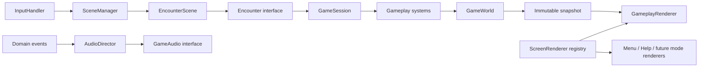

# Architecture

This is the foundation for a space game with several modes. Space Invaders is the first encounter implementation. The current build still plays the original game; exploration, finite-wave objectives, zones, warp travel and campaign persistence are not implemented yet.

## Boundaries

| Package | Responsibility |
| --- | --- |
| `app` | Composition root: wires implementations, scene registrations and application lifecycle. |
| `loop` | Fixed-step clock and the Swing scheduler adapter. |
| `scene` | Active scene, lifecycle, input routing, overlay history and encounter transitions. No painting. |
| `encounter` | Mode lifecycle and outcome contracts. The outer flow receives an encounter result. |
| `game` | Orchestrates the current Invaders run and its input state. |
| `world` | Owns live entities and supplies immutable snapshots/read-only views. |
| `entity` | Player, Alien, Mothership, Laser and simulation geometry. No rendering or resources. |
| `system` | Collision, formation movement, row spawning and boss milestones. |
| `control`, `event` | Semantic commands and domain events, independent of physical input and sound files. |
| `input` | Keyboard aliases, focus handling and screen-to-game pointer mapping. |
| `render` | Screen renderers, entity drawing strategies, animation presentation and viewport. |
| `asset` | Resource loading, validated asset metadata and cached sprite frames. |
| `audio` | Domain-to-sound mapping, reusable clips and the Java Sound adapter. |
| `ui` | Thin Swing panel/window adapters. |
| `config` | Gameplay dimensions and tuning. |

The build uses `jdeps` to enforce allowed package dependencies. Model, gameplay systems, encounter contracts and scenes cannot depend on AWT, Swing, sound devices, assets or renderers. Renderers cannot depend on the mutable session or world; they read snapshots through `GameView`.

## Runtime

The platform scheduler, input callbacks, simulation and painting all run on Swing's event thread. This keeps entity mutation single-threaded. The clock advances in 60 Hz fixed steps and caps catch-up after a stall. Graphics and physical audio resources have explicit lifecycle owners.

A scene owns behaviour and transitions; it does not own drawing. Each screen renderer receives the read model it needs. A future free-roam screen can use its own world and snapshot without pretending to be an Invaders screen.

## Extension points

- **A new enemy:** implement `Enemy` and register an `EntityRenderer` in `GameAssembly`. Collision code uses health, bounds and points through the interface. A new enemy may have its own movement system/policy; it does not need to pretend to be an alien row.
- **A different game mode:** implement the `Encounter` lifecycle/input contract and provide its own view and screen renderer. `EncounterScene` returns `EncounterResult` once through an injected completion callback.
- **Campaign and zones:** keep persistent world/zone/player progression outside the encounter. An outer director can start an encounter and consume its victory/defeat result before returning to exploration. It must not reset campaign state when an encounter resets.
- **Wave objectives:** introduce an encounter-specific objective policy with a configured wave target. Completion can return `VICTORY` through the existing result port. The current Invaders implementation retains the original endless/staggered spawning; a fake victory encounter tests the completion contract without claiming the campaign exists.
- **New scenes:** register behaviour with `SceneManager` and drawing with `GameRenderer`. Overlay history preserves the underlying encounter rather than constructing a new run.
- **Different input:** implement an adapter targeting `GameControls` / `PointerInput`. The model knows semantic left/right/fire commands, not key codes.
- **Different artwork:** edit `res/assets.properties`, or supply another `ResourceLoader` and `SpriteSource`. Source rectangles, frame count and animation timing are metadata. Source-image resolution is independent of entity collision dimensions.
- **Different audio backend:** implement `GameAudio`; the simulation still emits the same events. `ClipLoader` isolates device loading from cache/playback logic.
- **Different scheduling:** implement `GameLoop`; `FixedStepClock` is independent of Swing.

Interfaces are placed at these boundaries. Independent systems use concrete classes; there is no service locator, global mutable registry or one-method interface for every class.

## Verification

`build.ps1` compiles Java 21 with all compiler lint warnings treated as errors, checks architecture boundaries, runs the dependency-free regression suite and packages the assets into a runnable JAR. Tests include long simulation runs, real key/focus adapters, scene transitions, resource replacement at double resolution, a custom enemy and renderer, and a pluggable encounter returning victory.

Original game by Daniel Hodgson.
